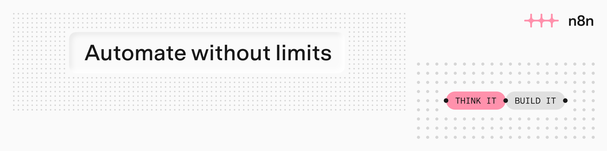
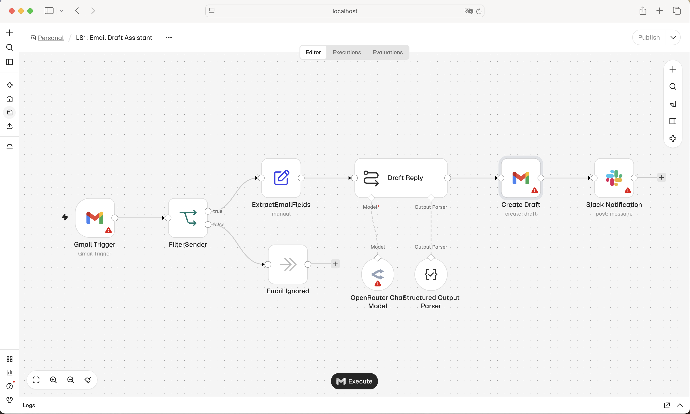

# n8n – The Platform for AI Agents and Workflow Automation

Fair-code platform to build and deploy AI agents and workflows. Combine a visual canvas with custom code, run it self-hosted or in the [cloud](https://app.n8n.cloud/login), and connect to 1500+ integrations. AI automation you can trust with real work, from prototype to production.



## Key Capabilities

- **AI-Native Automation Platform**: Build and operationalize AI workflows and multi-step agents using your own data, models, and tools
- **Model Flexibility, No Lock-In**: Connect to OpenAI, Anthropic, Google, or open-source models and switch providers without changing your architecture
- **From Prototype to Production**: Design multi-step AI workflows with logic, tool use, human approvals, and full observability
- **Code When You Need It**: Combine visual building with JavaScript, Python, and npm packages for advanced AI workflows
- **Enterprise-Ready AI**: Self-host or deploy securely with role-based access, audit trails, and support for sensitive data
- **Leverage What Already Exists**: 1500+ integrations and 9,000+ workflow [templates](https://n8n.io/workflows) to connect AI with your existing systems

## Standalone Local Setup

Clone this repository. Use Docker Desktop with Linux containers on Windows.

```sh
git clone https://github.com/pujahalder34675-creator/n8n2.git
cd n8n2
docker compose -f docker/compose.local.yml up --build -d
```

The local image builds from this checkout. Dependencies are fetched from their
registries with the committed lockfile. The build does not pull a prebuilt n8n
application image. The first build can take several minutes.

Access the editor at http://localhost:5678. Data stays in a named Docker volume.
Rebuild the image after source changes. See [CONTRIBUTING.md](CONTRIBUTING.md)
for local development with Node.js 24 or newer and pnpm 12.4.2.

Runtime service hooks remain in the source. To disable optional upstream
services, set these variables in the container environment:

```dotenv
N8N_DIAGNOSTICS_ENABLED=false
N8N_VERSION_NOTIFICATIONS_ENABLED=false
N8N_VERSION_NOTIFICATIONS_WHATS_NEW_ENABLED=false
N8N_TEMPLATES_ENABLED=false
N8N_PERSONALIZATION_ENABLED=false
N8N_HIRING_BANNER_ENABLED=false
N8N_SENTRY_DSN=
N8N_FRONTEND_SENTRY_DSN=
```

These settings do not disable integrations or all network access. A root `.env`
file supplies Compose substitutions; it does not automatically set container
variables. The local Compose file sets these defaults explicitly.

## Resources

- 📚 [Documentation](https://docs.n8n.io)
- 🔧 [1500+ Integrations](https://n8n.io/integrations)
- 💡 [Example Workflows](https://n8n.io/workflows)
- 🤖 [AI & LangChain Guide](https://docs.n8n.io/advanced-ai/)
- 👥 [Community Forum](https://community.n8n.io)
- 📖 [Community Tutorials](https://community.n8n.io/c/tutorials/28)

## Support

Need help? Our community forum is the place to get support and connect with other users:
[community.n8n.io](https://community.n8n.io)

## License

n8n is [fair-code](https://faircode.io) distributed under the [Sustainable Use License](LICENSE.md) and [n8n Enterprise License](LICENSE_EE.md).

- **Source Available**: Always visible source code
- **Self-Hostable**: Deploy anywhere
- **Extensible**: Add your own nodes and functionality

[Enterprise Licenses](mailto:license@n8n.io) available for additional features and support.

Additional information about the license model can be found in the [docs](https://docs.n8n.io/n8n-community-license/).

## Contributing

Found a bug 🐛 or have a feature idea ✨? Check our [Contributing Guide](CONTRIBUTING.md) for a setup guide & best practices.

## Join the Team

Want to shape the future of automation? Check out our [job posts](https://n8n.io/careers) and join our team!

## What does n8n mean?

**Short answer:** It means "nodemation" and is pronounced as n-eight-n.

**Long answer:** "I get that question quite often (more often than I expected) so I decided it is probably best to answer it here. While looking for a good name for the project with a free domain I realized very quickly that all the good ones I could think of were already taken. So, in the end, I chose nodemation. 'node-' in the sense that it uses a Node-View and that it uses Node.js and '-mation' for 'automation' which is what the project is supposed to help with. However, I did not like how long the name was and I could not imagine writing something that long every time in the CLI. That is when I then ended up on 'n8n'." - **Jan Oberhauser, Founder and CEO, n8n.io**
